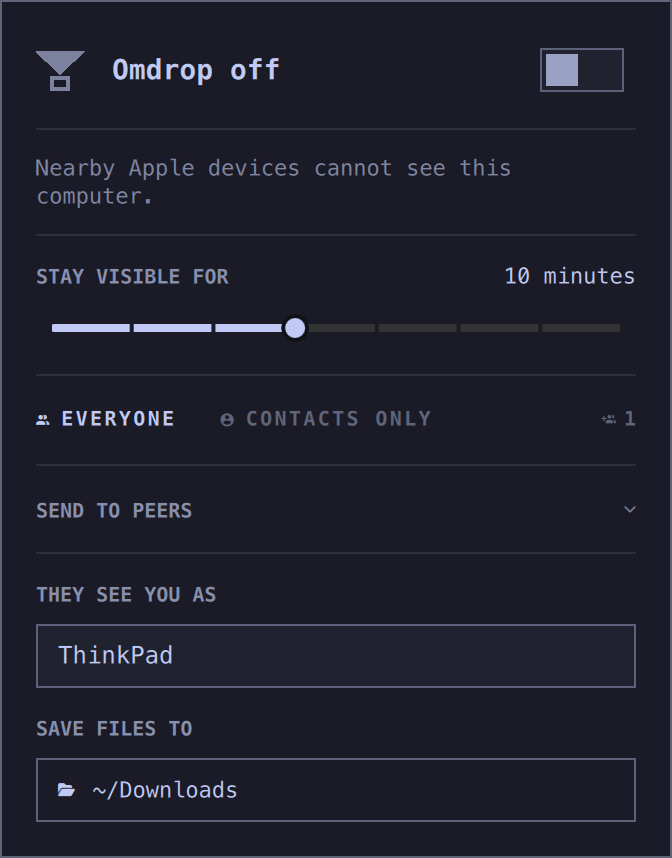

# The Owly demo panel on GNOME

This hosts the **original Omdrop QML panel shown in Owly's README video**.
The duration slider, Everyone / Contacts Only tabs, known senders, peer radar,
file sending, computer name and destination controls are upstream's code.
The GNOME indicator opens that panel. Its middle-click shortcut opens it directly;
with a normal click, select **Apri AirDrop…**.



The panel calls the installed Omdrop backend. The three Omarchy host components
(`Panel`, `KeyboardPanel`, `BarIconButton`) are replaced with a small standalone
host. GNOME doesn't implement layer-shell, so the popup uses XWayland. It opens
at the top right of the primary screen and closes on Escape or lost focus.
Other monitors and mixed display scales haven't been tested.

## Requirements and installation

Requires configured Owly / Omdrop, Quickshell 0.3.2, XWayland, QtQuick Controls,
Python GObject bindings, GTK3, AyatanaAppIndicator3, Zenity, and GNOME's
[AppIndicator extension](https://github.com/ubuntu/gnome-shell-extension-appindicator).
A Nerd Font supplies the original panel's glyphs (the adapter uses MesloLGS).
No Fdrop package or Python module is used.

On this CachyOS machine the Quickshell runtime was extracted from distro
packages into `~/.local/lib/owly-ui-runtime/usr`; the launcher prefers a system
Quickshell when installed. Runtime binaries aren't committed here.

Back up an existing `~/.local/share/omdrop-tray` installation first. From the
repository root, as your desktop user:

```bash
install -Dm644 desktop/tray.py ~/.local/share/omdrop-tray/tray.py
install -m755 desktop/panel desktop/omdrop.py ~/.local/share/omdrop-tray/
install -m644 desktop/omdrop-symbolic.svg ~/.local/share/omdrop-tray/
cp -a desktop/qml ~/.local/share/omdrop-tray/
install -Dm644 desktop/omdrop-tray.service ~/.config/systemd/user/omdrop-tray.service
systemctl --user daemon-reload
systemctl --user enable omdrop-tray.service
systemctl --user restart omdrop-tray.service
```

Opening the UI only reads status. Before a panel command can start the radio,
`omdrop.py` checks `owly doctor --json`; exclusive / active-monitor modes need
explicit confirmation that Wi-Fi disconnects. Failed probes block startup.
Stopping and rescheduling a live session keep the backend's normal behavior.
Continuous reception is Omdrop's **Until I turn it off** mode, not boot recovery.
On the lab AX211, simultaneous AirDrop and Wi-Fi works with the coexistence driver (below).

Disable the indicator with `systemctl --user disable --now omdrop-tray.service`.
This closes the UI only; turn reception off in the panel to release the radio.

## Wi-Fi + AirDrop insieme (coexistence driver)

With the patched driver loaded (`iwlwifi awdl_coex=1`, see `patches/README.md`) the tray
receives **without disconnecting Wi-Fi**. `omdrop.py` detects the driver and then:

- `on` / `toggle`: `pkexec coex-session start` brings up `awdlmon` (own AWDL MAC, channel 6) and
  Owly's AWDL engine (`awdl0`); `coex-receive.py` runs `owly receive --fixed-channel` as a user unit.
  Each offer appears as a GNOME notification with **Sì / No**, kept on screen; unanswered
  after 13 s it is withdrawn and the offer declined. Durations, "one file" and
  "until I turn it off" work as before.
- Name, download folder and audience come from Omdrop's settings. Only **Everyone** is supported here;
  Contacts Only is refused with a message. Sending is not available in this mode yet.
- `off` stops the receiver and the engine; `awdlmon` stays up on channel 6. `awdl-coex-boot.service`
  creates it at boot, before NetworkManager connects, so receiving never takes the station down.
  Without that service (or if it fails) the first start of a boot drops Wi-Fi for a few seconds.
- The tray menu shows the mode in use: "Wi-Fi + AirDrop insieme" or "AirDrop esclusivo".

Without the driver, the original exclusive path and its Wi-Fi warning are unchanged.

**Always on.** After `install-coex` AirDrop is on at every boot and stays visible until it is turned
off in the tray (it comes back at the next boot):

- `awdl-coex-boot.service` puts `awdlmon` on channel 6 before NetworkManager connects;
- `awdl-coex-radio.service` (system, enabled) runs Owly's AWDL engine once the network is online;
- `omdrop-coex-receive.service` (user, enabled) runs the receiver from login, reading name and folder
  from Omdrop; it restarts by itself when the radio comes back after a suspend;
- the `awdl-coex` system-sleep hook removes the monitor before suspend and restores it after: a monitor
  left up across suspend broke Wi-Fi until the driver was reloaded (docs/FINDINGS.md §14);
- turning the radio on or off by hand from the tray asks for your password (pkexec); turning only the
  receiver on or off while the radio runs doesn't.

**Kernel updates.** The patched driver is a DKMS package (`dkms/dkms.conf`, source in
`/usr/src/iwlwifi-awdl-coex-7.3`): pacman's DKMS hook rebuilds it for every new 7.3.x kernel.
On a 7.4 kernel DKMS skips it on purpose and the stock driver loads; the tray then shows
"AirDrop esclusivo" until the patch is ported.

Install (asks for sudo and installs the `dkms` package; Wi-Fi drops once only if the patched driver
isn't loaded yet):

```bash
desktop/install-coex
```

`desktop/install-coex --remove` removes everything and puts the stock driver back.

## Discovery comparison

The installed Omdrop Python path announces periodically through `omdrop-owl`'s
root supervisor, but it doesn't run a query responder. Owly's native receive
path also answers mDNS questions. In the 22:27 lab attempt the radio heard the
phone, but the receiver logged no requests. This difference is a **hypothesis**
for failed discovery, not a proven diagnosis.

`experiments/owly-mdns.rs` reuses Owly's mDNS implementation with the existing
lease, address, service ID, port, and hostname. It never acquires the radio or
changes the receiver's acceptance policy. The user service starts with the
receiver and stops when that receiver stops. For a controlled comparison:

```bash
install -m644 experiments/owly-mdns.rs \
  ~/awdl-diag/owly/crates/owly-cli/examples/owly-mdns.rs
cargo build --manifest-path ~/awdl-diag/owly/Cargo.toml --locked --release \
  -p owly-cli --example owly-mdns
install -m755 ~/awdl-diag/owly/target/release/examples/owly-mdns \
  ~/.local/share/omdrop-tray/owly-mdns
install -m755 desktop/mdns ~/.local/share/omdrop-tray/
install -Dm644 desktop/airdrop-mdns.service ~/.config/systemd/user/airdrop-mdns.service
systemctl --user daemon-reload
systemctl --user enable airdrop-mdns.service
```

Then start reception from the panel and check `journalctl --user -u airdrop-mdns`.
The extra responder is installed/enabled in the lab, but a new file transfer
through this path has not been verified. Disable it with
`systemctl --user disable --now airdrop-mdns.service` to restore the comparison.

## Source and verification

- Omdrop: [ee475b2](https://github.com/netmojo-systems/omdrop-plugin/tree/ee475b2977c88fa9d2d6ef29068a3c5e4800b0ee).
  `Panel.qml`, `Radar.qml`, `OmdropIcon.qml` are reused. The panel's only changes
  select the CLI/sound paths, expose a UI-opening IPC method, and avoid calling
  a lost radio "waking" for 200 seconds.
- Omarchy UI: [9ac0883](https://github.com/omacom/omarchy/tree/9ac08836cf786c242e514cee8dfac8808e7ee641/shell).
  Controls, border helpers and style tokens are reused. Hyprland and Omarchy
  config watchers are omitted; the host supplies fixed colors and font.
- Both upstream MIT notices are in `licenses/`.

Validation: 12 Python tests, 10 Owly mDNS protocol tests, native responder
compilation, live QML rendering, opening the installed panel from the indicator,
and continued HTTPS connectivity with the radio idle. No phone transfer or
concurrent AirDrop/Internet claim follows from those UI checks.

```bash
/usr/bin/python3 -B -m unittest discover -s tests -v
cargo test --manifest-path ~/awdl-diag/owly/Cargo.toml --locked \
  -p owly-airdrop --lib proto::mdns
```
